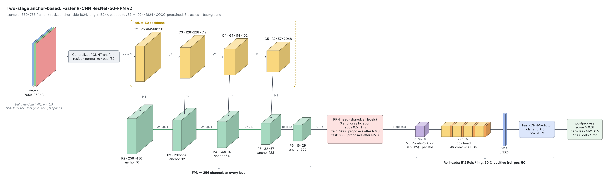
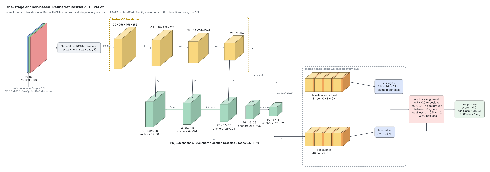
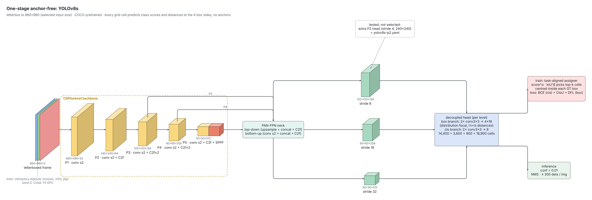
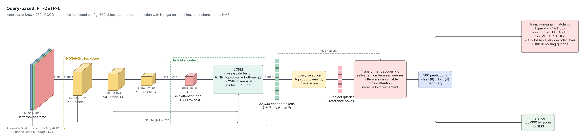
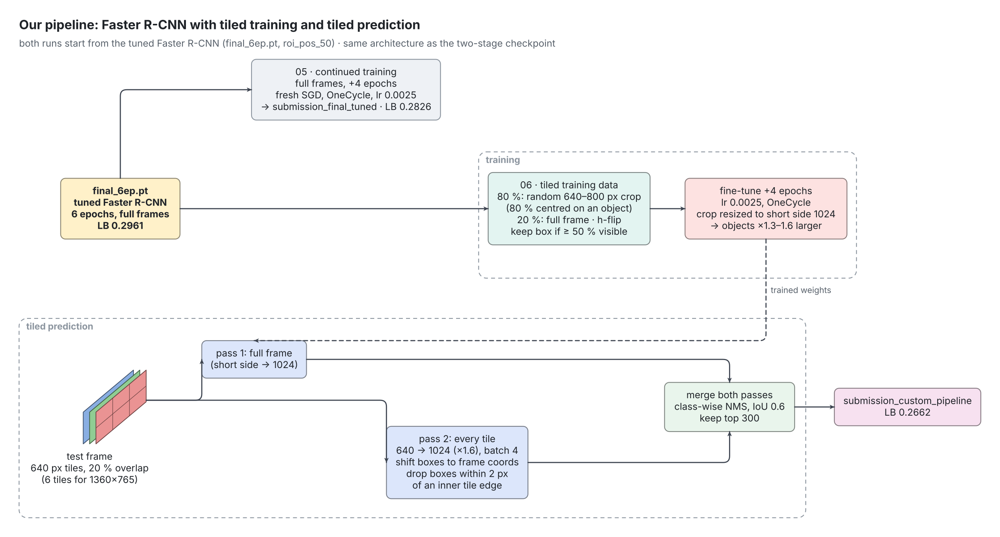

<!--
SKELETON. Write every TODO in your own words: reports are checked for AI-written text.
Target: about 1500 words in total. Keep it a summary, not logs.
Numbers below were copied from the saved notebook outputs. Check each one, fill the
blanks (TODO), and add public LB scores for every Kaggle submission.
Images go in images/ and are referenced as .
Only report.md and images/ may be changed; do not touch index.html, assets/ or .github/.
-->

## Repository

| Notebook | Content |
|---|---|
| `data_preparation/01_dataprep.ipynb` | EDA and preprocessing |
| `two_stage_anchor_based/02_two_stage_anchor.ipynb` | Faster R-CNN (two-stage, anchor-based) |
| `one_stage_anchor_based/one_stage_anchor_based.ipynb` | RetinaNet (one-stage, anchor-based) |
| `one_stage_anchor_free/04_one_stage_free.ipynb` | YOLOv8s (one-stage, anchor-free) |
| `query_based/query_based.ipynb` | RT-DETR-L (query-based) |
| `fine_tuning_tsab/05_fine_tuning_tsab.ipynb` | Continued training of the tuned Faster R-CNN |
| `custom_pipeline_tsab/06_custom_pipeline_tsab.ipynb` | Final pipeline: Faster R-CNN with tiled training and prediction |

## 1. Data understanding and preprocessing

Code: `data_preparation/01_dataprep.ipynb`.

| | train | val | test |
|---|---|---|---|
| clips | 56 | 7 | 48 |
| frames | 24,201 | 2,846 | 3,811 |
| objects | 1,105,516 | 114,132 | – |
| frames with ignore regions | 75 % | 50 % | – |
| median long side | 1904 px | | 1360 px |

### Class balance

| class | train | val |
|---|---|---|
| car | 45.7 % | 27.9 % |
| person | 29.7 % | 44.1 % |
| motor | 9.3 % | 10.5 % |
| van | 4.2 % | 6.0 % |
| tricycle | 3.7 % | 4.8 % |
| bicycle | 3.6 % | 5.3 % |
| truck | 2.8 % | 1.2 % |
| bus | 0.9 % | 0.2 % |

TODO (your words): long tail (car : bus = 52 : 1 in train); val class mix differs from train (only 7 clips); bus/truck per-class AP on val is noisy (264 and 1,359 instances).

### Object size, density, occlusion

| share of objects (size at 1280 px long side) | < 8 px | < 16 px | < 32 px | < 64 px |
|---|---|---|---|---|
| train | 0.6 % | 9.8 % | 54.2 % | 89.0 % |
| val | 0.7 % | 8.7 % | 48.4 % | 91.1 % |

| per frame | train | val |
|---|---|---|
| objects, mean / median / max | 45.7 / 43 / 180 | 40.1 / 37 / 116 |
| ignore regions (when present) | 3.5 | 2.8 |
| median ignore coverage (when present) | 1.6 % | 1.4 % |
| occluded objects | 45.7 % | 59.1 % |
| truncated by the frame border | 4.3 % | 5.3 % |

TODO (your words): what these mean for the models: input resolution (half the objects are COCO-small), multi-scale necks, permissive NMS and up to 300 detections per image, train frames being larger than test frames (test has 680×382 and 960×540 clips).

### Preprocessing

| step | choice | evidence |
|---|---|---|
| split | provided clip-level train/val split, never by frame | consecutive frames are near-duplicates, a frame split leaks |
| cleaning | check box validity, class ids, COCO vs YOLO labels; deduplicate ignore regions (listed 8× in the json) | nothing had to be removed |
| sub-sampling | every 3rd frame in train and val (24,201 → 8,090 train frames) | median box IoU of the same object: 0.9 after 1 frame, 0.73 after 3 |
| ignore regions | train: filled with grey 114, labelled boxes restored; val: kept, marked `iscrowd=1` so COCO eval ignores detections there | regions hold real but unlabelled objects |
| resolution | torchvision models: short side 1024, long ≤ 1824; YOLO: 960; RT-DETR: 1280 (letterbox) | at 640 px about half the objects fall under 16 px, at 1280 about 10 % |
| augmentation | random horizontal flip (torchvision); Ultralytics defaults for YOLO / RT-DETR | |

TODO (your words): how GT boxes were verified visually (add a figure), and why you kept the provided split instead of K-fold.

### Validation design

All models are scored with the same pycocotools evaluation on the val clips (mAP, AP50, AP_small, ms/img, max 300 detections). Parameter studies use evenly spaced subsets (2,000 train / 500 val frames, 2 epochs); final models use all frames.

TODO (your words): why a single clip-level split is acceptable here (compute budget) and its limits (7 val clips).

<!--  -->

## 2. Two-stage anchor-based: Faster R-CNN

Setup: TODO (ResNet50-FPN v2, COCO weights, anchors 16-256, min/max size 1024/1824, SGD + OneCycle, ...).

| Run (2 ep, subset) | mAP | AP50 | AP_small | ms/img |
|---|---|---|---|---|
| baseline | 0.2419 | 0.4974 | 0.1135 | 383 |
| rpn_low (500/250 proposals) | 0.2347 | 0.4723 | 0.1161 | 353 |
| rpn_high (4000/2000 proposals) | 0.2338 | 0.4857 | 0.1146 | 432 |
| roi_pos_50 (50% positive RoIs) | 0.2446 | 0.5005 | 0.1282 | 435 |

Final model (6 ep, full data): mAP TODO, AP50 TODO, AP_small TODO, ms/img TODO. Public LB: **0.2961** (`submission_faster_rcnn.csv`).

TODO: what the RPN and the second stage each contribute.

TODO: at least three failure cases with plausible causes (add images).

## 3. One-stage anchor-based: RetinaNet

TODO: anchor configuration grounded in object sizes (k-means aspect ratios 0.5 / 1.02 / 2.01; 27.6% of boxes under 32 px after resizing).

| Run (2 ep, subset) | mAP | AP50 | AP_small | AP_medium | AP_large |
|---|---|---|---|---|---|
| baseline (default anchors, α=0.25, γ=2) | 0.1841 | 0.3525 | 0.0688 | 0.1647 | 0.3450 |
| anchors_small | 0.1581 | 0.3446 | 0.0677 | 0.1460 | 0.2698 |
| anchors_small_kmeans | 0.1583 | 0.3444 | 0.0679 | 0.1464 | 0.2699 |
| focal γ=1.5 | 0.1883 | 0.3590 | 0.0714 | 0.1689 | 0.3475 |
| **focal α=0.5** | 0.1930 | 0.3773 | 0.0705 | 0.1744 | 0.3596 |
| IoU fg/bg 0.4/0.3 | 0.1667 | 0.3158 | 0.0551 | 0.1477 | 0.3249 |
| IoU fg/bg 0.5/0.3 | 0.1833 | 0.3578 | 0.0631 | 0.1658 | 0.3505 |

TODO: why smaller anchors did not help despite better anchor coverage.

TODO: what removing the proposal stage causes (≈463 background anchors per positive) and how focal loss addresses it.

Final model (checkpoint after 4 of 6 epochs): mAP TODO. Public LB: **0.2131** (`submission_retinanet_ep4.csv`). TODO: comparison with tuned Faster R-CNN.

## 4. One-stage anchor-free: YOLOv8s

TODO: how locations are assigned to objects without anchors (task-aligned assigner) and the effect on small and dense objects.

| Run | Input size | P2 head | mAP | AP50 | AP_small | ms/img |
|---|---|---|---|---|---|---|
| TODO | | | | | | |

Final model (input 960): mAP 0.1354, AP50 0.2661, AP_small 0.0569, 22.4 ms/img. Public LB: **0.1365** (`submission_yolo.csv`).

TODO: search range, chosen settings, comparison with anchor-based models broken down by object size.

## 5. Query-based: RT-DETR-L

| Run (subset) | mAP | AP50 | AP_small | AP_medium | AP_large | AR@300 |
|---|---|---|---|---|---|---|
| baseline | 0.1057 | 0.1940 | 0.0433 | 0.0863 | 0.2334 | 0.3357 |
| **queries 500** | 0.1437 | 0.2629 | 0.0594 | 0.1327 | 0.2761 | 0.3116 |
| backbone lr ×0.1 | 0.1000 | 0.1842 | 0.0366 | 0.0894 | 0.2212 | 0.3279 |
| denoising queries 300 | 0.0927 | 0.1728 | 0.0437 | 0.0838 | 0.1908 | 0.2950 |
| matching GIoU weight 4 | 0.0788 | 0.1421 | 0.0294 | 0.0713 | 0.1719 | 0.2861 |

Final model: mAP 0.2821, AP50 0.5246, AP_small 0.1444, AR@300 0.4335. Public LB: **0.2530** (`query_based/submission_final.csv`).

TODO: bipartite matching and why no NMS is needed; effect on training dynamics.

TODO: validation mAP over training vs a CNN detector under the same budget (the model was still improving at the end).

<!--  -->

## 6. Our pipeline

TODO: why Faster R-CNN was chosen as the base (justify from sections 2-5).

TODO: data / inference changes (tiled training and tiled prediction) and model changes (continued training), each evaluated separately.

| Step | mAP | AP50 | AP_small | Public LB |
|---|---|---|---|---|
| Tuned Faster R-CNN (6 ep) | | | | 0.2961 |
| + continued training, full frames (+4 ep, `05`) | | | | 0.2826 |
| + tiled training (+4 ep from the 6-ep model, `06`) | | | | TODO |
| + tiled prediction (`06`, submitted) | | | | 0.2662 |

### Summary of all models

| Model | mAP | AP50 | AP_small | ms/img | Public LB |
|---|---|---|---|---|---|
| Faster R-CNN (tuned) | | | | | 0.2961 |
| RetinaNet (tuned, 4 ep) | | | | | 0.2131 |
| YOLOv8s | 0.1354 | 0.2661 | 0.0569 | 22.4 | 0.1365 |
| RT-DETR-L | 0.2821 | 0.5246 | 0.1444 | | 0.2530 |
| Continued training (`05`) | | | | | 0.2826 |
| Tiled pipeline (`06`) | | | | | 0.2662 |

### Unsuccessful attempts

TODO

## 7. Final model and how to run

TODO: which submission(s) were selected and why (validation, not only public LB).

1. Environment: TODO (Colab / Kaggle, GPU, package versions, e.g. `ultralytics==8.4.202`, `pycocotools`).
2. Data: TODO (where the dataset must be and how `DRIVE_ROOT` is set).
3. Run `data_preparation/01_dataprep.ipynb`, then TODO.
4. Seeds: `torch.manual_seed(0)`; TODO others.
5. Submission file: TODO.

## References

TODO: every paper, library and code source used.
