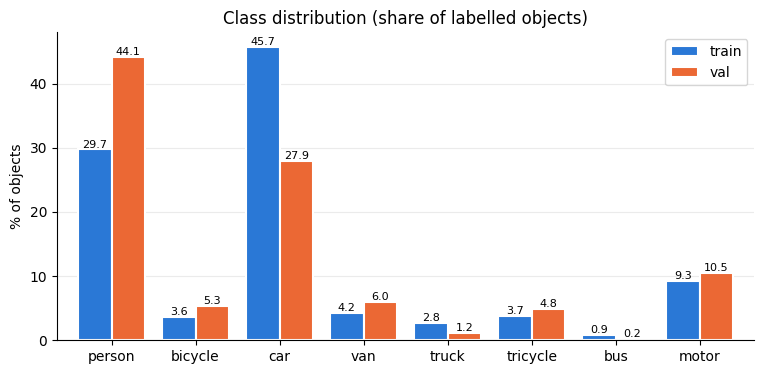
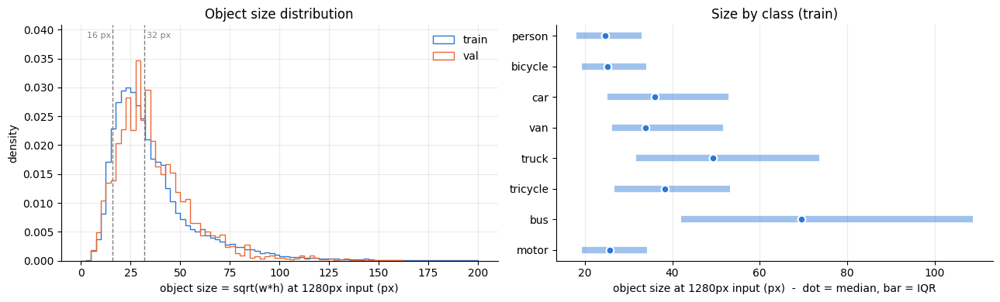
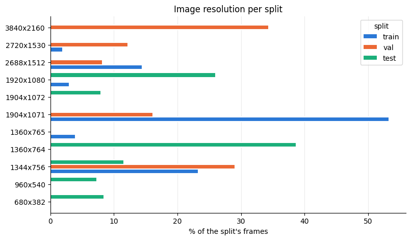
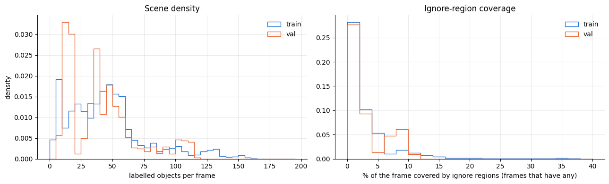
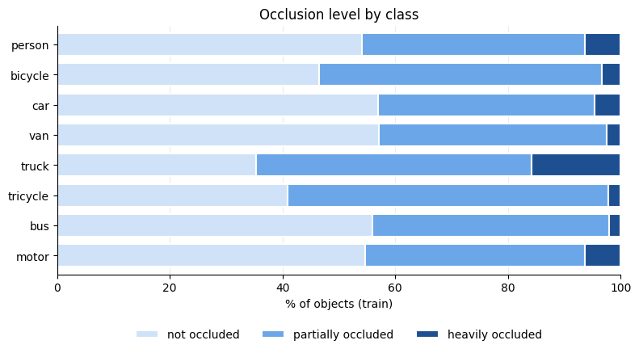
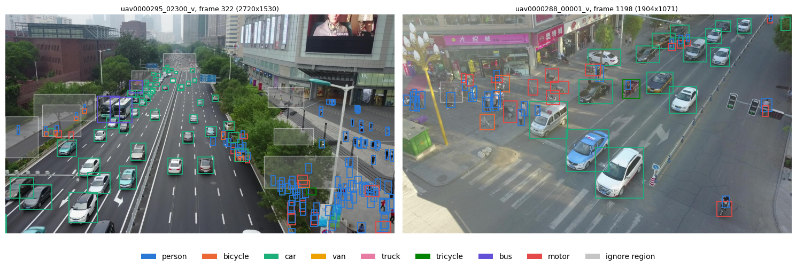
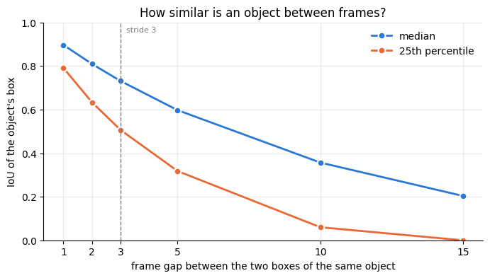
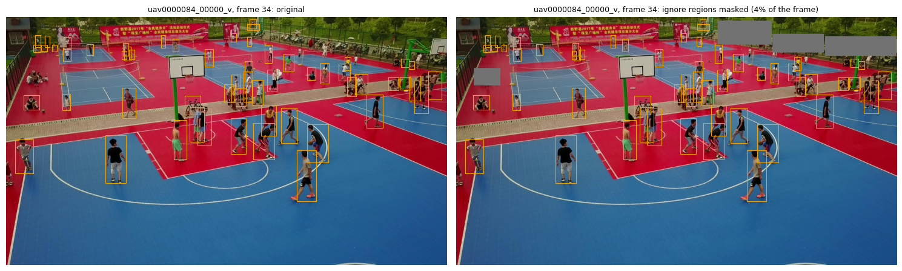
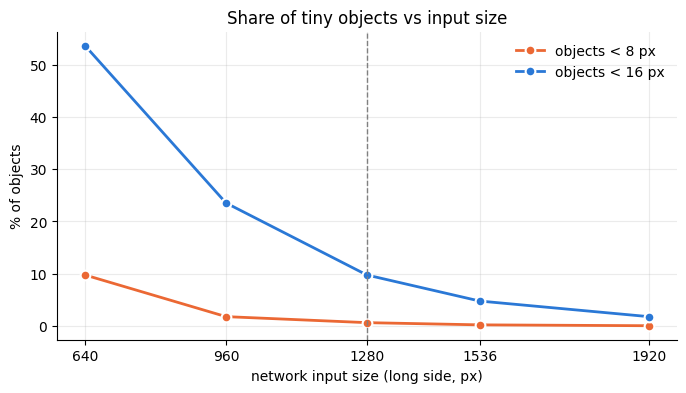

<!--
SKELETON. Write every TODO in your own words: reports are checked for AI-written text.
Target: about 1500 words in total. Keep it a summary, not logs.
Numbers below were copied from the saved notebook outputs. Check each one, fill the
blanks (TODO), and add public LB scores for every Kaggle submission.
Images go in images/ and are referenced as .
Only report.md and images/ may be changed; do not touch index.html, assets/ or .github/.
-->

## Repository

| Notebook | Content |
|---|---|
| `data_preparation/01_dataprep.ipynb` | EDA and preprocessing |
| `two_stage_anchor_based/02_two_stage_anchor.ipynb` | Faster R-CNN (two-stage, anchor-based) |
| `one_stage_anchor_based/one_stage_anchor_based.ipynb` | RetinaNet (one-stage, anchor-based) |
| `one_stage_anchor_free/04_one_stage_free.ipynb` | YOLOv8s (one-stage, anchor-free) |
| `query_based/query_based.ipynb` | RT-DETR-L (query-based) |
| `fine_tuning_tsab/05_fine_tuning_tsab.ipynb` | Continued training of the tuned Faster R-CNN |
| `custom_pipeline_tsab/06_custom_pipeline_tsab.ipynb` | Final pipeline: Faster R-CNN with tiled training and prediction |

## 1. Data understanding and preprocessing

Code: `data_preparation/01_dataprep.ipynb`.

### Class balance

**Observations**
The class distribution is clearly long-tailed: car makes up almost 46% of the objects in train, while bus is only 0.9% in train and 0.2% in val. The distributions of train and val also differ: in val, person is the largest class (44%) and car drops to 28%. This is most likely because val contains only 7 clips, so a few scenes decide its class mix.
**Implications**
Rare classes have very few training examples, so their AP is low, and on val it is also noisy because of the small number of instances. Moreover, they worsen the mAP badly, because mAP is a plain average over classes and a rare class counts as much as car. That is why we tuned focal loss in the RetinaNet checkpoint. We also look at per-class and per-size AP, not only mAP, to account for the imbalance.

About half of the objects are COCO-small (less than 32x32=1024px^2). About 10% are less than 16x16px. Larger input size keeps small objects visible even after downsampling. At 640 px half the objects would drop under 16 px, so you used short side 1024 (torchvision), 960 (YOLO) and 1280 (RT-DETR). Moreover, both large and small objects may appear at the same frames. that is why FPNs were used.  

### Image resolution

Train frames tend to be larger than test frames. The median long side is 1904 px in train and 1360 px in test.

### Scene density and ignore regions

There are about 46 objects per frame in train and 40 in val, up to 180. (6-8% of frames have over 100). Objects often touch/intersect so we keep NMS permissive (IoU 0.7 for YOLO and RT-DETR) with a low score treshold of 0.01.
Up to 300 detections per image cover even the densest frame.
Ignore regions are in 75% of train frames and 50% of val frames (about 3.5 per frame) but the median coverage is only about 1.5% of the frame. They contain real unlabelled objects so we decided to mask them in training.

### Occlusion and truncation

We decided to keep the occluded objects in training.  

### Ground-truth check

### Preprocessing

We measure average IoU of the object's box from frame `k` to itself in frame `k + lag` for `lag` in `{1, 2, 3, 5, 10, 15}`. At the lag 3, the median IoU is .75 which is reasonable, so we train on every third frame.

In train, we grey out ignore regions but restore labelled object boxes inside them, otherwise the model would learn them as background. 
In val we did not mask so it matches test, the regions stay as iscrowd=1 (pycocotools neither rewards nor penalises detections inside them)

At 640 about half the objects are <16px, at 1280 only about 10% and above that the gains get small.
Faster RCNN and RetinaNet use short side 1024 and long side up to 1824 which is close to native resolution. 
For YOLO, 960 is chosen over 640 by experiment (mAP 0.148 vs 0.125).  
For RT-DETR 1280, the final pipeline adds 640px for small objects.

### Validation design

All models are scored with the same pycocotools evaluation on the val clips (mAP, AP50, AP_small, ms/img, max 300 detections). Parameter studies use evenly spaced subsets (2,000 train / 500 val frames, 2 epochs); final models use all frames.

We do only a single split because on a single T4 with runs taking tens of minutes we couldnt afford k-fold. One fixed split keeps the comparison between models fair.
The limits are:
- 7 clips is 7 scenes.
- class mix differs from train
- rare classes (e.g bus) make perclass AP and mAP noisy

## 2. Two-stage anchor-based: Faster R-CNN

**Setup**

- **Architecture:** `fasterrcnn_resnet50_fpn_v2` from torchvision, with ResNet-50 and FPN levels P2–P6.
- **Pretrained weights:** `FasterRCNN_ResNet50_FPN_V2_Weights.DEFAULT`, i.e. trained on COCO.
- **New head:** the box predictor is replaced with a `FastRCNNPredictor` for 8 classes plus background (9 outputs).
- **Anchors:** sizes 16, 32, 64, 128 and 256, one per FPN level, with aspect ratios 0.5, 1 and 2.
  - The torchvision default is 32–512. It was shifted down one octave for small objects.
  - There are still 3 anchors per location, so the pretrained RPN head weights still fit.
- **Input size:** `min_size=1024`, `max_size=1824`.
- **Inference:** `box_detections_per_img=300`, `box_score_thresh=0.01`, and torchvision's default box NMS IoU of 0.5.
- **Chosen setting from the study:** `box_positive_fraction=0.5` (`roi_pos_50`), meaning 50% positive RoIs per batch instead of the default 25%. It won with mAP 0.2446 against the baseline's 0.2419.

| Run (2 ep, subset) | mAP | AP50 | AP_small | ms/img |
|---|---|---|---|---|
| baseline | 0.2419 | 0.4974 | 0.1135 | 383 |
| rpn_low (500/250 proposals) | 0.2347 | 0.4723 | 0.1161 | 353 |
| rpn_high (4000/2000 proposals) | 0.2338 | 0.4857 | 0.1146 | 432 |
| roi_pos_50 (50% positive RoIs) | 0.2446 | 0.5005 | 0.1282 | 435 |

The submitted model is the 2-epoch `roi_pos_50` run (2,000 train frames): mAP 0.2446, AP50 0.5005, AP_small 0.1282, 435 ms/img on the 500-frame val subset. Public LB: **0.2961** (`submission_faster_rcnn.csv`).  

The region proposal network suggests regions without tying them to class. We tried cutting the proposals to 500/250 but the result wasn't better than default of 4000/2000.

**Three possible failure cases**:
- Tiny objects are missed (AP_small is 0.12, overall mAP is 0.2446) + almost half of all objects are under 32px. roi_pos_50 gave the largest AP_small gain (more positive examples in the RoI head helped small objects the most)
- Suppressed neighbours or duplicate boxes in dense scenes
  - supported by EDA (46% of train objects are occluded in train, 59% in val)
  - the box NMS has fixed IoU treshold of .5
  - Lowering the treshold would leave duplicates
- Confusion between similar vehicle classes (van vs car or truck vs van)
  - From above they may look similar
  - Van is only 4.2% of train objects, truck is 2.8% (car is 45.7%)
  - Truck is the most occluded class
  - The classifier is biased towards car

## 3. One-stage anchor-based: RetinaNet

**Anchor configuration**

- **Object sizes after the model's resize** (short side 1024, long side ≤ 1824; 1.1M train boxes): median 43 px, 5th-95th percentile 19-119 px; 2.2% under 16 px, 27.6% under 32 px, 76.4% under 64 px.
- **Aspect ratios:** k-means (k = 3, on log h/w) gives 0.5 / 1.02 / 2.01, practically the default 0.5 / 1 / 2.
- **Anchor sets compared** (3 scales per level, 2^0, 2^(1/3), 2^(2/3), × 3 ratios = 9 anchors per location):
  - `default`: base sizes 32-512 on P3-P7 (torchvision).
  - `small`: base sizes 16-256, one octave down.
  - `small_kmeans`: 16-256 with the k-means ratios.
- **Shape coverage** (best centred-anchor IoU, 100k sampled boxes):

| Anchors | Mean best IoU | IoU ≥ 0.5 | Small boxes, IoU ≥ 0.5 |
|---|---|---|---|
| default | 0.760 | 90.1% | 64.1% |
| small | 0.822 | 99.3% | 97.8% |
| small_kmeans | 0.822 | 99.3% | 97.8% |

- **Kept:** `default`, since it had the best mAP in the 2-epoch study (table below).

| Run (2 ep, subset) | mAP | AP50 | AP_small | AP_medium | AP_large |
|---|---|---|---|---|---|
| baseline (default anchors, α=0.25, γ=2) | 0.1841 | 0.3525 | 0.0688 | 0.1647 | 0.3450 |
| anchors_small | 0.1581 | 0.3446 | 0.0677 | 0.1460 | 0.2698 |
| anchors_small_kmeans | 0.1583 | 0.3444 | 0.0679 | 0.1464 | 0.2699 |
| focal γ=1.5 | 0.1883 | 0.3590 | 0.0714 | 0.1689 | 0.3475 |
| **focal α=0.5** | 0.1930 | 0.3773 | 0.0705 | 0.1744 | 0.3596 |
| IoU fg/bg 0.4/0.3 | 0.1667 | 0.3158 | 0.0551 | 0.1477 | 0.3249 |
| IoU fg/bg 0.5/0.3 | 0.1833 | 0.3578 | 0.0631 | 0.1658 | 0.3505 |

Smaller anchors did not help despite better anchor coverage. Smaller anchors cover small boxes better when centred on them. However, the number of anchors stays the same and each object is matched on a coarser FPN level. As a result, positives drop from 21 to 6.5 averages per object and the imbalance goes from 409 to 1343 background per positive.

Without the RPN, RetinaNet classifies all ~350k anchors per image. That's ~409 background per positive, compared with ~3:1 after Faster R-CNN's RoI sampling.
The easy negatives would dominate a cross enthropy loss. The fix is the focal loss:

$$
\mathrm{FL}(p_t) = -\alpha_t \, (1 - p_t)^{\gamma} \, \log(p_t),
\qquad
p_t = \begin{cases} p & \text{positive anchor} \\ 1 - p & \text{background anchor} \end{cases}
$$

Each anchor's loss is scaled by $(1-p_t)^\gamma$ , so confidently classified background contributes almost nothing. The loss is later normalised by the number of positives and the bias of 0.01 keeps the start of training stable.
$\alpha = 0.5$  gave the best mAP, since equal weight on positives helps when each object has only about 21 positive anchors.

 Public LB: **0.2131** (`submission_retinanet_ep4.csv`)  

## 4. One-stage anchor-free: YOLOv8s

- **How the assigner works:** grid points inside the box are candidates, scored by class score × IoU, and the top 10 become positives.
- **The difference from RetinaNet:** the assignment depends on the predictions and changes during training, instead of fixed IoU thresholds.
- **Small objects:** they contain only a few grid points, so they get few positives (AP_small 0.0569).
- **P2 and density:** the P2 head would add more points but underperformed in 2 epochs, and in dense frames neighbouring objects compete for the same points.

| Run (2 ep, subset) | Input size | P2 head | mAP | AP50 | AP_small | ms/img |
|---|---|---|---|---|---|---|
| **baseline** | 960 | no | 0.1482 | 0.2904 | – | – |
| imgsz_640 | 640 | no | 0.1246 | 0.2488 | – | 10.1 |
| p2_head | 960 | yes | 0.0720 | 0.1537 | – | 18.7 |

Study metrics are the Ultralytics validator's (mAP50-95 and mAP50 on the 500-frame val subset), not pycocotools, so AP_small is not available; ms/img is Ultralytics' preprocess + inference + postprocess time on the T4. The 1280 run was defined but not trained.

Final model (input 960): mAP 0.1354, AP50 0.2661, AP_small 0.0569, 22.4 ms/img. Public LB: **0.1365** (`submission_yolo.csv`).

**Search range:** input size {640, 960} (1280 defined but not trained) and detection head {P3-P5, P3-P5 + P2}; 2 epochs on the 2,000 / 500-frame subsets. Assigner, losses and optimizer stay at the Ultralytics defaults.

**Chosen settings:** input 960, standard P3-P5 head (`baseline`).

**Comparison with the anchor-based models by object size:**

| Model | Evaluated on | mAP | AP50 | AP_small | AP_medium | AP_large |
|---|---|---|---|---|---|---|
| Faster R-CNN (`roi_pos_50`, 2 ep) | 500-frame val subset | 0.2446 | 0.5005 | 0.1282 | – | – |
| RetinaNet (`focal_alpha0.5`, 2 ep) | 500-frame val subset | 0.1930 | 0.3773 | 0.0705 | 0.1744 | 0.3596 |
| YOLOv8s (960, 2 ep) | full val (2,846 frames) | 0.1354 | 0.2661 | 0.0569 | – | – |

All three are pycocotools metrics. AP_medium and AP_large were only computed in the RetinaNet notebook, and the YOLO row uses the full val set rather than the subset, so the comparison by size is limited to AP_small.
Faster R-CNN is clearly best on small objects (0.128 vs 0.071 vs 0.057), probably thanks to its RoI resampling and smaller anchors.

## 5. Query-based: RT-DETR-L

| Run (subset) | mAP | AP50 | AP_small | AP_medium | AP_large | AR@300 |
|---|---|---|---|---|---|---|
| baseline | 0.1057 | 0.1940 | 0.0433 | 0.0863 | 0.2334 | 0.3357 |
| **queries 500** | 0.1437 | 0.2629 | 0.0594 | 0.1327 | 0.2761 | 0.3116 |
| backbone lr ×0.1 | 0.1000 | 0.1842 | 0.0366 | 0.0894 | 0.2212 | 0.3279 |
| denoising queries 300 | 0.0927 | 0.1728 | 0.0437 | 0.0838 | 0.1908 | 0.2950 |
| matching GIoU weight 4 | 0.0788 | 0.1421 | 0.0294 | 0.0713 | 0.1719 | 0.2861 |

Final model: mAP 0.2821, AP50 0.5246, AP_small 0.1444, AR@300 0.4335. Public LB: **0.2530** (`query_based/submission_final.csv`).

TODO: bipartite matching and why no NMS is needed; effect on training dynamics.

TODO: validation mAP over training vs a CNN detector under the same budget (the model was still improving at the end).

<!--  -->

## 6. Our pipeline

TODO: why Faster R-CNN was chosen as the base (justify from sections 2-5).

TODO: data / inference changes (tiled training and tiled prediction) and model changes (continued training), each evaluated separately.

| Step | mAP | AP50 | AP_small | Public LB |
|---|---|---|---|---|
| Tuned Faster R-CNN (6 ep) | | | | 0.2961 |
| + continued training, full frames (+4 ep, `05`) | | | | 0.2826 |
| + tiled training (+4 ep from the 6-ep model, `06`) | | | | TODO |
| + tiled prediction (`06`, submitted) | | | | 0.2662 |

### Summary of all models

| Model | mAP | AP50 | AP_small | ms/img | Public LB |
|---|---|---|---|---|---|
| Faster R-CNN (tuned) | | | | | 0.2961 |
| RetinaNet (tuned, 4 ep) | | | | | 0.2131 |
| YOLOv8s | 0.1354 | 0.2661 | 0.0569 | 22.4 | 0.1365 |
| RT-DETR-L | 0.2821 | 0.5246 | 0.1444 | | 0.2530 |
| Continued training (`05`) | | | | | 0.2826 |
| Tiled pipeline (`06`) | | | | | 0.2662 |

### Unsuccessful attempts

TODO

## 7. Final model and how to run

TODO: which submission(s) were selected and why (validation, not only public LB).

1. Environment: TODO (Colab / Kaggle, GPU, package versions, e.g. `ultralytics==8.4.202`, `pycocotools`).
2. Data: TODO (where the dataset must be and how `DRIVE_ROOT` is set).
3. Run `data_preparation/01_dataprep.ipynb`, then TODO.
4. Seeds: `torch.manual_seed(0)`; TODO others.
5. Submission file: TODO.

## References

TODO: every paper, library and code source used.
